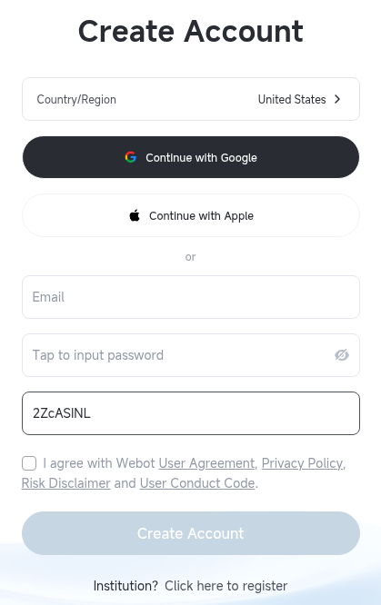

# Pionex.US referral code: 2ZcASINL (as of November 2026)

**Enter 2ZcASINL as your Pionex.US referral code** in the "Referral code (optional)" field of the sign-up form, before you submit it. The third character is a lower-case c.

## Where does the referral code go?

The Pionex.US sign-up form has one optional box for it, labelled "Referral code (optional)". Codes are normally tied to an account when it's created, so fill it in on that first screen.

## Steps

1. Open the Pionex.US sign-up page or app.
2. Register with your email or phone and set a password.
3. Paste `2ZcASINL` into "Referral code (optional)".
4. Complete registration and the identity checks.

## What does the code change?

Pionex.US decides under its own program terms whether a referral is recorded and whether any reward applies. We don't promise a bonus.

## Typos that break it

- A capital C in third place (it must be lower-case).
- A space before or after the code.
- Leaving the box empty and trying to add it later.

## FAQ

**Is this an invite code?** People search for it as an invite or referral code; there's only one box.

**Is Pionex.US open in every state?** No, check availability for your state first.

---
*Disclosure: 2ZcASINL is our referral code and we may be rewarded if you use it. Crypto trading carries risk.*
